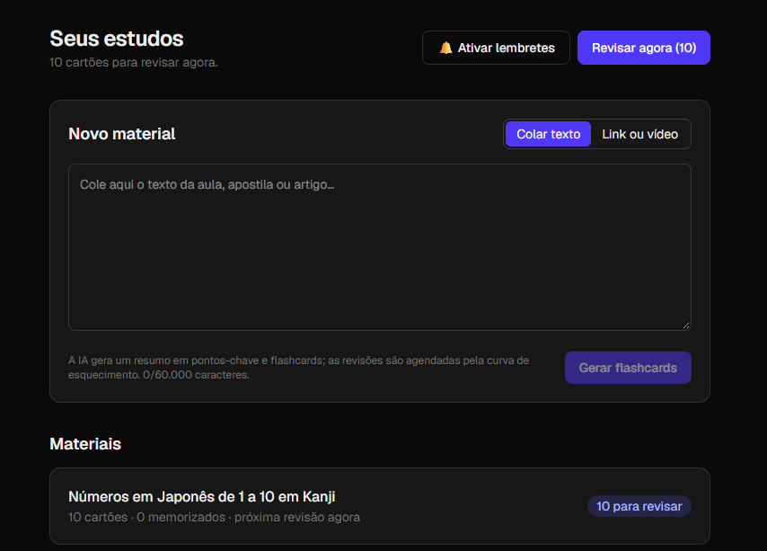
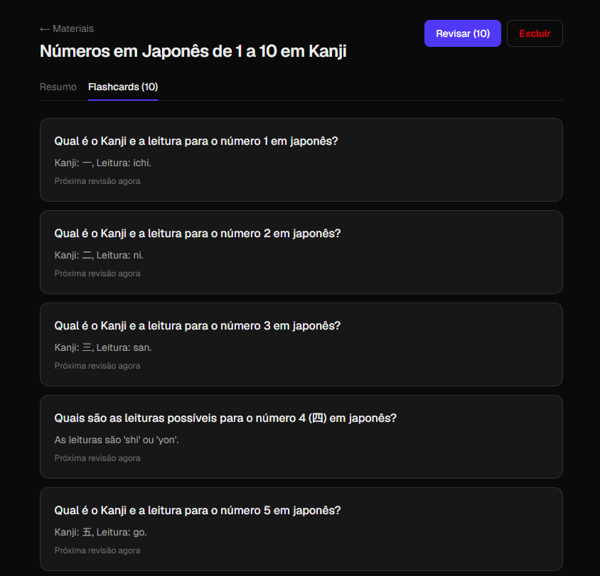

# Estudos — resumos e flashcards com repetição espaçada

Cole um texto de aula ou um link: a IA (Gemini) gera um resumo em pontos-chave e
flashcards, e as revisões são agendadas pela curva de esquecimento (algoritmo SM-2).
Contas e dados ficam no Supabase, com login por e-mail/senha ou Google.

**▶ [Acessar o app](https://web-flashcards-ten.vercel.app/)** — dá para testar sem conta no modo visitante.

## Demonstração

<table>
  <tr>
    <td width="50%" valign="top"></td>
    <td width="50%" valign="top"></td>
  </tr>
  <tr>
    <td align="center"><b>Painel</b> — cole um texto, link ou vídeo e acompanhe as revisões</td>
    <td align="center"><b>Material</b> — resumo e flashcards gerados pela IA</td>
  </tr>
</table>
